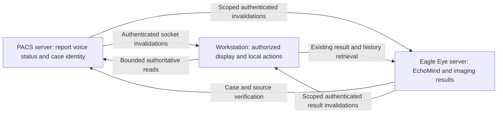

# PACS Client and Eagle Eye realtime implementation and initial review

The initial review below records the pre-change baseline. Source implementation
now connects PACS workflow sockets to authenticated Eagle Eye case notifications
and Patient clients. See the implementation receipt at the end.

At the initial review, the existing PACS socket channel supported bounded workflow invalidations and
authoritative state reconciliation. It does not yet provide the requested
three-node synchronization, server history discovery in Patient, or red EchoMind
and Eagle Eye sidebar availability indicators. This review records the source
evidence, the owner's shared-center decision, and the implementation contract.

Initial review date: 2026-10-06. Runtime code was inspected and existing synthetic tests
were executed. No runtime behavior, server configuration, deployment, credentials,
or clinical records were changed. All design sections below describe required
work, not implemented capabilities.

## Owner requirements

- Connect the PACS server, workstation clients, and authenticated Eagle Eye server
  through immediate change notifications and authoritative retrieval.
- Synchronize voice availability, report content changes, report/workflow status,
  EchoMind saved responses, and Eagle Eye analysis states/results.
- Share previous EchoMind and Eagle Eye results among all authorized users of the
  same center. This is an explicit owner decision in this session, not permission
  to share between centers or to bypass current authentication.
- Mark the vertical Patient EchoMind/Eagle Eye buttons red when a matching saved
  server result is available. Opening it retrieves the existing result; it must
  not silently initiate another inference request.

## Verified source boundaries

| Boundary | Current implementation | Gap for the requested behavior |
| --- | --- | --- |
| PACS mutation to socket | `D:/pacs server INO/servers/socket_server.py` publishes report status, audio availability and assignment/list changes through `utils/workflow_realtime.py`. | Version 1 does not advertise a report-content revision event, EchoMind result events, or Eagle Eye result events. |
| Socket to workstation | `modules/network/workflow_realtime.py` negotiates `SubscribeToEvents`, reads `GetWorkflowStates` on another socket, coalesces bursts, reconnects, and reconciles every 30 seconds. | Snapshot fields are report status, assignment, and audio count. They cannot prove the current report body or AI result availability. |
| Workstation GUI consumer | `PacsClient/pacs/workstation_ui/home_ui/workflow_realtime.py` refreshes up to 100 visible Home rows for the active server/search generation. | This consumer does not subscribe the open Patient tabs or update their AI buttons and loaded report/voice contents. |
| Eagle Eye job service | `modules/ai_imaging/eagle_eye_remote/server.py::Jobs` persists job states and artifacts. Authenticated HTTP exposes recent owner jobs, job state, cancellation and ZIP artifacts. | No event subscription route exists in this handler. `recent(owner)` returns at most 50 owner jobs, not a study-specific center history. |
| Eagle Eye workstation client | `modules/ai_imaging/eagle_eye_remote/client.py` observes jobs and resumes credential/server-bound saved local handles. ZIP extraction validates identity, inventory and checksums. | Local-handle resume does not discover results created on another workstation. There is no case history client API. |
| EchoMind server | `eagle_eye_remote/echomind/hosting.py` saves request and response through `text_history.py::History` before returning. | `History` exposes write methods only. The HTTP handler has no history list/get endpoints or saved-result broadcasts. |
| EchoMind association | `modules/EchoMind/remote_backend.py::bind_history` captures optional study/session context for a worker. `History.validate_context` permits study UID and session ID. | Context is client-origin and explicitly not a PACS identity claim. It lacks a server-verified PACS namespace/center/reception association. Unbound historical entries must not be assigned by guessed identity. |
| Patient navigation | The active five-button UI is `_pw_panels.py::sidebar_layout_ui`, not the separate three-button `sidebar_widget.py`. `_safe_set_sidebar_button_style` uses selection alone. | Neither saved-result discovery nor red availability state is connected to these buttons. Eagle Eye currently opens its workspace. |
| Upstream reception changes | PACS `servers/reception_sync_service.py` also emits reception/workflow events after synchronization; its documented external polling default is two minutes. | Local socket speed cannot eliminate upstream polling latency. Existing v1 workstation events do not include those reception-specific names. |

Audio invalidation is not an increment: the PACS also uses `audio_uploaded` after
removal, and consumers must reread `audio_count`. A saved voice, a transcript, an
AI draft, and a finalized PACS report are separate resources. Do not interpret
one as evidence of another.

## Authoritative three-node flow

Keep each source authoritative for its own durable state. PACS owns report,
voice and workflow resources; Eagle Eye owns its job/artifact store and EchoMind
history. A single universal broadcast store is unnecessary. Clients combine
their verified projections, rather than write AI history into the PACS database
or send raw reports/voice bytes to every subscriber.

The PACS-to-Eagle Eye connection needs an explicitly scoped service identity and
a verified mapping to the configured PACS source. Do not reuse a GUI session as
a permanent service credential, select a source by display name, or enable the
production Agent Gateway as a substitute. New company inference remains on the
authenticated Eagle Eye server, with server-owned prompts and provider keys.

Events announce durable changes only after persistence succeeds. They contain a
resource kind, opaque result/resource ID, verified case reference, epoch and
revision. Report bodies, prompts, filenames, audio bytes and artifact payloads
are retrieved separately under authorization. Events never replace clinical truth.

## Required event and retrieval contracts

Suggested names are a proposed versioned contract, not currently callable APIs.

| Resource | Invalidation | Authoritative retrieval |
| --- | --- | --- |
| Voice | Existing audio availability event, with resource revision when introduced | Voice inventory/count and authorized file retrieval; cover upload and delete |
| Report | Existing status event plus new report-content change invalidation | Current report metadata/content with independent content revision |
| Workflow | Assignment, report status and relevant reception/workflow invalidations | Verified current status and reception/study association |
| EchoMind | Request state and durable response create/update/delete invalidation | Case-scoped response list, metadata and exact saved response |
| Eagle Eye | Job state and durable artifact availability/revision invalidation | Case-scoped analysis list and exact existing artifacts |

Negotiate capabilities before requesting new events or endpoints. Preserve the
four-byte framing and current PACS request/download protocols. Use a dedicated
bounded event connection for each source, separate from responses/artifacts.
The Eagle Eye transport must preserve its current TLS/token/client-certificate
checks; adding a bare unauthenticated socket port is not acceptable.

Subscribe before the first case snapshot. Reconcile after reconnect, server epoch
change, overflow/EOF, and periodically. Coalesce bursts and bound watched cases,
queue sizes, payload sizes and concurrent readers. Support explicit missing,
deleted, unavailable and permission-revoked states. A network error is unknown
availability, not proof that no result exists. Source publication revision is not
a contiguous per-subscriber clinical version.

Avoid automatically rerunning AI when a PACS source changes: mark the relevant
result/source relationship and let the user deliberately create a new analysis.
Read an existing result without POSTing a new job. Existing `Client.resume`
resubmits the same idempotent request for recovery; that mechanism is not a
cross-user shared-result retrieval contract.

## Shared-center access and case identity

Current Eagle Eye `Jobs.get` requires the creating owner. Do not loosen it to
all configured owners. Add a server-owned center membership model, verified case
access, and a separate shared read permission; retain creator ownership for
cancellation, edits and correction proposals. Client-supplied owner/center fields
cannot grant access. A center-level shared token is not proof of an individual
user's PACS authorization.

Bind discovery and retrieval to the verified center/PACS source namespace,
StudyInstanceUID and authoritative patient/reception link. Patient names and
patient IDs alone are not sufficient, particularly across sources, repeated
studies or multiple-study admissions. Read the exact request/result's series,
SOP and revision where applicable. Reject a delayed result after tab navigation,
server switch, credential change or destruction.

Index case-scoped history and paginate it. Do not list every historical job or
scan private SQLite history during every repaint. Existing history entries
without sufficient verified context remain unassociated until an explicit safe
migration proves their binding. Empty context must never match every patient.

## Patient button and retrieval behavior

Maintain selection and availability as separate states. A saved, accessible
result takes the red availability treatment, including when the button is
selected; preserve selection through a border/indicator and a descriptive
tooltip. Red indicates available saved content, not a pathological finding or
clinical urgency. Queued/running/failed jobs alone do not make a button red.

On Patient open, asynchronously retrieve current case availability from the
configured Eagle Eye server. Subscribe the open case independently of whether
its Home row is visible. Reset and rebind when the case/source changes; remove
availability when the final saved result is deleted or access is revoked.
Unknown/disconnected state needs a clear connection indication and retry.

EchoMind opens a case-scoped history picker and displays the chosen original
saved response. Eagle Eye opens a module/result picker and retrieves the chosen
artifact using the existing secure archive/identity validation and the module's
existing presentation adapter. Where there are multiple previous results,
display timestamps, module and source/revision rather than silently overwrite
the current view. Preserve unsaved local edits; notification arrival must not
replace the user's draft or interrupt voice recording.

Network, SQLite and file work belongs on workers. GUI updates use bounded
queued delivery with generation/identity checks; no blocking joins or requests
in the sidebar paint/click path. Keep viewer decoding and private caches in
their existing execution domains.

## Verification receipt

Existing suites on the inspected dirty source trees:

- Workstation direct pytest: `tests/code/network/test_workflow_realtime.py`,
  `tests/code/ui_services/test_workflow_realtime_ui.py`, and
  `tests/code/ai_imaging/test_eagle_eye_remote.py`: **43 passed**, exit **0**.
  Three existing SWIG deprecation warnings occurred.
- PACS direct pytest: `tests/test_workflow_realtime.py`,
  `tests/test_socket_transfer.py`, `tests/test_attachment_upload.py`:
  **72 passed**, exit **0**.
- Actual PACS socket AST harness with two real workstation receivers through
  `tools/testing/workflow_wire_acceptance.py --server-root`: **passed**, exit
  **0**. Assignment, report status, voice availability, burst, reconnect and
  missed-event reconciliation were covered with synthetic data.
- Documented Test Control fallback `client.py ping`: exit **1**, named source
  test listener unavailable. No GUI acceptance is claimed. No application was
  launched/restarted and no installed executable or production gateway was used.

These tests certify existing tested boundaries only. They do not verify the new
history, shared-center authorization, button coloring, three-node event path,
deployment, or clinical acceptance.

## Implementation sequence and acceptance gates

1. Establish verified center membership and PACS case binding. Specify shared
   read versus creator mutation permissions and legacy history migration.
2. Add paginated case history and direct saved-result retrieval endpoints to
   Eagle Eye/EchoMind. Prove cross-center denial, same-center authorized reads,
   patient/study isolation and original result identity with synthetic guards.
3. Publish bounded durable result invalidations on the authenticated Eagle Eye
   listener, and connect the scoped PACS service subscription. Extend PACS
   report-content/reception contracts without changing download behavior.
4. Add a worker-owned Patient case coordinator and connect the active five-button
   mixin to availability. Integrate exact prior-result display through existing
   EchoMind and Eagle Eye adapters; retain unsaved edits and recording state.
5. Run fail-before/pass-after guards for stale callbacks, disconnect/reconcile,
   deletion, burst/slow consumers, auth revocation, history pagination, source
   switching and selected-red presentation. Update the regression catalog and
   owning contracts with actual implementation receipts.
6. Verify scoped plugin mirrors/build inputs and then the fresh-source GUI:
   two authorized clients observe a result created on either, both buttons update
   for the exact case, selecting retrieves that result without inference, and
   unrelated cases/centers remain unchanged. Human source launch/sign-in and
   documented control preflight are required. Build/deploy acceptance is separate.

Follow the existing optimization master plan for any reliability implementation
slice; this review is a subsystem contract and does not establish a competing
optimization backlog. Runtime implementation and live acceptance remain open.

## Source implementation receipt, 2026-10-06

The owner authorized implementation after the initial review. The initial gap
and design sections above remain historical evidence, not current capability claims.

### Implemented contract

- PACS publishes metadata-only attachment changes in its existing authenticated
  socket protocol. Workflow snapshots include document count, a content-inventory
  revision and legacy audio availability. Optional exact attachment names select
  original files before file reading or encoding.
- Eagle Eye `case_realtime.py` authorizes exact StudyInstanceUID/PatientID against
  authenticated PACS metadata and server-owned center membership. `pacs_case_bridge.py`
  consumes PACS sockets and publishes bounded invalidations to all authorized
  same-center case readers. Different-center and wrong-patient access are rejected.
- Authenticated `/v1/cases/snapshot`, `/events`, `/text`, `/job` and `/artifacts`
  provide paginated history, held notifications and original saved results.
  Notifications use held HTTP connections (authenticated long polling), while
  the upstream PACS connection uses its existing framed socket protocol.
  Epoch/revision cursors, overflow reconciliation, reconnect and periodic snapshots
  recover missed events. Clinical text and file bytes are retrieved explicitly;
  they are absent from broadcast messages.
- EchoMind publishes only after its private history transaction completes. Eagle
  Eye publishes after durable job state changes. Shared reads do not grant another
  user's cancel/update rights. Existing owner job routes stay owner-scoped.
- `case_receiver.py` runs network work outside Qt. `case_ui.py` updates the actual
  vertical Patient buttons: saved results are red and the selected button retains
  a blue border. Exact selected-study binding, active PACS profile checks and
  dialog/worker retirement reject stale results across study and source changes.
- Previous EchoMind responses, saved Eagle Eye results, original report documents
  and voice recordings are explicitly retrieved without another inference call.
  Original media is validated and atomically cached in an isolated `.server-media`
  directory. Active brain edits are preserved when opening saved history.
- Server startup pins history/job roots to the configured center and PACS source.
  Existing paired clients default to the configured center; `center_id` and
  server-owned `client_centers` can define membership. No client selects its center.
  `pacs.socket_port` defaults to 50052. Optional `pacs.client_host` advertises a
  client-reachable hostname; clients retain their selected profile's public port.
  Co-located loopback source mapping requires the authenticated Eagle endpoint and
  active PACS profile to agree. No credential or deployment configuration was edited.

### Evidence and remaining acceptance gates

The synthetic three-node acceptance script uses actual PACS socket handler logic,
the Eagle Eye bridge/HTTP service and two real case receiver workers. It passed
PACS-to-Eagle-to-clients delivery, report status, voice/document arrivals, original
voice/report retrieval, shared EchoMind and Eagle Eye history, no repeat inference
and forced PACS reconnect. It never starts a clinical server or reads a live database.

Guards: `test_case_realtime.py`, `test_case_realtime_http.py`,
`test_pacs_case_resources.py`, `test_patient_case_realtime.py`, and PACS
`test_case_report_realtime.py` / `test_case_attachment_selection.py`.
PACS revision and exact-name guards failed before the corresponding fixes.
The initial missing case-service guard failed collection before implementation;
GUI and later boundary guards were added during implementation and are not claimed
as fail-before evidence. The staged standard-library Eagle Eye client also passed
shared history/artifact retrieval without importing server implementation modules.

Fresh-source GUI acceptance is pending: Test Control `ping` reported an unavailable
local listener. AGENTS.md requires the human to launch one source app with
`run_app.ps1 -TestServer` outside clinical work and sign in manually. No source or
installed clinical app was launched, restarted or signed into by this work.

Global mirror verification matched 511/512 files. The existing unrelated
`modules/EchoMind/viewer_chat/ai_chat_pages.py` mirror drift causes three edition
renderer parity failures. Current changed runtime files have no packaged mirrors;
that unrelated in-progress payload was preserved. An adjacent pre-existing
long-prompt literal guard also fails with its involved source files unchanged from
HEAD; the remaining selected EchoMind guards pass. No lint pass is claimed.

Standard and ARM clients must consume the Patient helpers in both PyInstaller and
Nuitka builds; Eagle Eye servers own the case service/bridge/private history.
Source and staged-client tests do not qualify these six release artifacts.
No packaging, push, deployment, release or installed acceptance was performed.

Final verification: workstation case/network/Patient/remote suite 71 passed;
PACS case/workflow/socket suite 62 passed; adjacent EchoMind selected suite
48 passed, one pre-existing prompt guard deselected. All three commands exited 0.
The final three-node wire acceptance exited 0. Scoped diff whitespace and Python
AST checks passed. These automated gates are separate from pending live GUI.

## Alignment availability correction, 2026-10-06

Reported: a study with a retained Alignment result had a gray Eagle Eye button.
Confirmed source gap: the local sidebar inventory called only brain discovery,
while Alignment PDF generation writes exact-study `report.json` / `report.pdf`
companions under hashed study directories. Existing remote downloads can retain
these companions even when the server case-history capability is unavailable.
The supplied screenshot establishes the gray button; it does not establish the
running process version or whether its Eagle Eye server has this source change.

Fixed: worker-only Alignment discovery checks embedded study identity, report
format, measurements, owned paths, bounded file sizes and the PDF checksum.
The Patient inventory now combines brain and Alignment results. Red availability
opens a local result chooser; opening Alignment rereads and verifies the original
report on the worker, without inference. Brain reopening is preserved. Changed
studies and delayed reads cannot apply the previous result. Local reports remain
local; no upload or cross-center sharing is inferred from their presence.

Fail-before: `test_local_alignment_report_is_in_sidebar_inventory` failed because
no Alignment row was found (exit 1). Pass-after: 30 focused Patient, Alignment
PDF/review and payload tests passed (exit 0), including red styling, original PDF
reopening, another-study rejection and changed-file rejection. Fresh-source GUI
is pending: Test Control ping is unavailable. A running process predating this
fix cannot verify it. No clinical app was started/restarted and no build/deployment
was performed. Standard/ARM clients and Eagle Eye profiles in both build backends
need this source in the next candidate; current installers are not qualified.
Rollback is removal of the additional local Alignment inventory and picker branch;
the existing authenticated server history remains unchanged.

## Complete module and workflow coverage, 2026-10-06

Owner scope: Bone Age, Total Spine, lower-limb Alignment, Brain/lesions, Breast,
EchoMind reports, status, voice, images and reporting physician.

The shared-center server case inventory already reads all succeeded job modules;
new parameterized guards cover all six module identifiers. Completed EchoMind
report history is shared by exact study and authorized center. Client retained
result discovery now covers authenticated remote downloads for every module,
exact-study legacy Bone Age/Breast engine receipts, Alignment companions and Total
Spine companions. The original result's study identity is required; patient names
and filenames are never sufficient. New downloads and server artifact packets
persist the module identity. Local EchoMind history is discovered and reopened by
exact study, separately from the server's shared history. Local files are not
silently uploaded or represented as center-wide server results.

Red availability covers both server and retained results. The history picker
includes local results alongside server results on its first page, and retrieves
existing artifacts/responses without inference. Brain's specialized recovery is
preserved. Local reads stay on workers and retired study/dialog bindings reject
late results. Synthetic tests isolate EchoMind history and attachment roots.

PACS workflow snapshots now carry bounded image/series counts in addition to
report status, attachment revision, voice availability and reporting/typing doctor
identity. Study-created/updated and audio-deleted events normalize to existing v1
invalidation types; legacy subscribers retain their original event contract.
The Patient consumer displays current physician/image metadata in Reception,
updates status/voice, and requests the existing asynchronous thumbnail loader when
image/series counts change. This uses the existing shared catalog entry point;
no viewer decoding or rendering implementation is changed. Image attachments use
the same explicit exact-case original-file retrieval as voice and reports.

Fail-before evidence: six retained-module inventory cases failed before the
additional discovery; the PACS image-count guard failed with missing snapshot
fields before the change. Pass-after includes shared-center module coverage,
local report reopening, original EchoMind text, mixed histories, exact-study
rejection, changed PDFs and doctor/image GUI state using synthetic Qt inputs.
The actual socket/HTTP bridge acceptance passed with two clients: reporting doctor,
image inventory, image attachment/original image, report status, voice/document,
original voice/report, shared AI history, no repeated inference and reconnect.
Fresh-source GUI remains unverified because Test Control ping failed. A human
fresh source launch and sign-in is required by AGENTS.md; no app restart, release,
credentials change or server deployment was performed.

Next-build source handoff: `case_ui.py`, `local_results.py`, `client.py`,
`artifacts.py`, `modules/network/workflow_realtime.py` and PACS workflow/socket
sources. Standard/ARM client UI/discovery and Eagle Eye server artifact/workflow
contracts apply to both PyInstaller and Nuitka; Slicer staged stdlib client reads
remain separately tested. There are no mirrors for changed files. The unrelated
EchoMind ai_chat_pages mirror drift is preserved. Produced artifacts and clinical
GUI acceptance remain pending, not implied by code tests.

Final complete-coverage verification: 105 workstation/Patient/network/remote/
selected builder tests and 63 PACS workflow/socket tests passed (exit 0).
The expanded three-node acceptance passed, including original image retrieval.
Python AST, scoped whitespace and PACS documentation catalog checks passed.
Mirror verification retains the existing unrelated 511/512 parity result.

## Operational Home investigation, 2026-10-07

Owner report: Home does not reflect report/status/physician/assignment changes
until Search or Sync. This investigation does not authorize clinical deployment
or restart, and no runtime code or server configuration was changed.

A read-only unauthenticated protocol-detection probe was sent to the configured
PACS socket using `GetWorkflowStates` and a synthetic UID. The server returned
an unknown-endpoint error, rather than the source handler's expected unauthorized
workflow response. No patient payload or credentials were requested or printed.
The active profile matched the socket configuration and profiles were enabled.
This establishes that the configured operational endpoint does not expose the
new workflow snapshot contract. It does not establish its exact installed version
or whether a different live endpoint was selected in the running GUI.

The receiver requires authenticated v1 subscription/snapshot negotiation. On an
unsupported negotiation it sets `unavailable` and exits. Home currently does not
surface that receiver status. Thus successful ordinary Search/Sync proves only
the existing patient-query path, not the live workflow contract. Earlier source
and synthetic acceptance receipts explicitly did not deploy the operational
PACS server; they cannot certify this endpoint.

Additional source findings, not all reproduced operational causes:

- `WorkflowRealtime._active_key` admits only Server mode with the exact bound
  server/search generation and a socket token. Local Home is excluded.
- Home binds realtime after normal or advanced Server search. A new search
  generation invalidates the prior binding until the replacement bind finishes.
- Visible rows only (up to 100) are watched. This is a deliberate bounded view;
  periodic authoritative reconciliation runs every 30 seconds after negotiation.
- `_apply` reads reporting physician from the old table role. Snapshot assignment
  identifies radiologist/typist, but that is not automatically the actual report
  author/approver. The existing post-search physician hydration is a separate
  path; its success after Search does not prove a live report-author refresh.
- Reception sync emits `reception_updated` / `reception_workflow_changed`, which
  are not the receiver's currently negotiated workflow events. Its default
  upstream poll is two minutes; configured timing was not inspected.

Verification: 15 focused network/Home Qt tests passed, exit 0. These exercise
synthetic compatible servers/cells, not the configured unsupported operational
endpoint. Test Control ping remains unavailable; current GUI mode, worker status
and affected-workflow live acceptance were not observed. The user was asked
whether Home is in Server or Local mode; that answer remains pending.

Required next steps: qualify the exact operational PACS endpoint against the v1
contract and deploy/restart it only under separate clinical deployment authority;
verify Home mode/token/binding and expose a visible unsupported/disconnected
status; establish the authoritative report-author field and its live update path;
cover Reception-to-workflow invalidation and Local mode according to owner intent.
Until those gates pass, operational live synchronization remains unverified.

## Home live update source correction, 2026-10-07

The owner authorized fixing the operational investigation's findings. Runtime
changes are now implemented; operational deployment/restart was not performed.

### Changes

- Home owns a visible `homeWorkflowRealtimeStatus` label and an inspectable
  `workflowRealtimeStatus` property. Connected broadcast, legacy periodic updates,
  reconnect, unsupported/unauthorized and source-switch states are distinguished.
  Ordinary Socket Connected/Search success cannot masquerade as live acceptance.
- Home opts into compatibility reads only when negotiation succeeds without v1
  or explicitly reports an unknown endpoint/unsupported protocol. Authorization
  rejection, including unknown-token errors, never enables compatibility.
  Every compatibility request carries the signed-in socket token. No credential
  collection, login automation or unauthenticated retry was introduced.
- Compatibility uses existing `GetPatientStatus` plus bounded `GetPatientList`
  queries for visible exact PatientID/StudyInstanceUID pairs. Requests, identity,
  response size and inventory bounds are checked; at most 20 watched studies are
  processed per 15-second batch. These are periodic socket queries, not broadcast.
  Larger visible batches rotate; endpoint rejection is visibly reconnecting.
  An unsupported old server is not represented as a v1 server to Eagle Eye.
- Local search resolves the active PACS profile on its existing worker pool and
  binds the same Home adapter in Local mode. Generation/source/token checks,
  retirement and no-GUI-join behavior remain. Live updates overlay the visible
  Local rows; no new background writes to the live local DICOM database were added.
- Reporting physician uses the actual Reception/report authority, independently
  of assigned radiologist. Existing static authenticated Reception fetch/extract
  helpers run on the receiver worker, with a PACS inventory cross-check. A
  reception result without an explicit study is admitted only for the authoritative
  latest matching study; an explicit mismatch or different patient is rejected.
  Actor IDs use the existing authenticated full-name resolver. Repeated snapshots
  can update report status and author without another Search; cached table author
  is replaced only when an authoritative value is present.
- Server assignment remains visible when the local INO history feature is off.
  Unknown legacy assignment data cannot erase a known assignment. Local completed
  assignment lifecycle overlays remain when that feature is enabled.
- PACS snapshot projection carries an explicitly stored report-author field when
  available. Reception updated/workflow-changed events normalize to existing v1
  patient-list invalidations; private Reception payload bodies are absent from v1
  events. Legacy event contracts and strict Eagle Eye bridge negotiation remain.

### Evidence

Three Home guards failed before production changes: Local binding unsupported,
missing protocol status label, and cached reporting author not replaced. The
INO-disabled server-assignment guard also failed before its fix. A new Local
source resolver guard caught and corrected its initial display-name mismatch.
The real synthetic old socket listener delivers completed status, voice and
assignment without Search, and authorization rejection cannot trigger downgrade.
Reception tests cover latest/older study isolation, author change and actor-name
resolution. The preview-retirement fixture lacked the already-required selected
server name; the fixture was aligned with the production panel contract without
changing the existing Server search implementation.

Final commands exited 0: 71 focused workstation/Home/search/network/case/selected
builder tests; 31 PACS workflow/report/attachment tests. The actual two-client
three-node socket/HTTP acceptance again passed doctor, images, status, voice,
original media, shared results and reconnect. Mirror verification: 513/513 pairs
match. Scoped whitespace and Python syntax checks passed; PACS catalogs refreshed.
No repository-wide, lint or produced-artifact pass is claimed.

### Periodic latency root-cause investigation, 2026-10-07

The owner reports slow sequential blue voice confirmation and asks whether
Periodic is the intended online state. Current bounded synthetic-identity probes
confirm SubscribeToEvents succeeds without realtime_version and GetWorkflowStates
returns a correlated unknown-endpoint error. This proves the operational source
lacks this client's negotiated v1 snapshot contract; it does not prove that the
server has no older event publisher. No private identity or token was used.

Client analysis finds a second independent defect: a legacy batch performs
GetPatientStatus and GetPatientList serially per patient, then ReceptionOverlay
performs a Reception read and duplicate GetPatientStatus per patient. Mailbox
publication occurs only after all reads and transformation finish. A synthetic
20-study counting harness verifies 20 status + 20 metadata + 20 Reception + 20
duplicate-status reads before publication (80 total), excluding name-resolution
and Mongo retries. The loop then sleeps another 15 seconds; that is not a
15-second refresh deadline. A theoretical one-second average per read gives an
80-second batch plus sleep, not a measured clinical latency. Multiple rotating
batches compound this delay. The Qt mailbox timer is 500 ms and is not the
principal bottleneck identified here.

Periodic is an explicit temporary compatibility state, not completed realtime
delivery. Server-side contract activation and end-to-end event verification remain
necessary. Further source work should publish voice facts independently of report/
physician enrichment, reuse the initial exact-study inventory rather than duplicate
it, and reconcile slow metadata separately. No runtime changes or fabricated live
acceptance were made in this investigation; no clinical service was restarted.

### Home assignment and voice presentation correction, 2026-10-07

The supplied screenshot shows duplicate voice icons and widespread red Assign/
Report rendering while Periodic is active. The compatibility adapter incorrectly
promoted latest-study radiologist metadata into active assignment evidence. It
now accepts only an explicit assignment object on the exact study; otherwise
assignment remains unknown, the existing Assign cell is preserved, and reporter
metadata cannot inject an assigned-person display into the Report cell. Three
fail-before cases cover direct and real framed legacy delivery; a separate guard
preserves an explicit assignment. No completion is inferred from a voice file.

Server voice counts now feed the existing status-chip renderer through a
container property. Local and server availability share one microphone, blue
when available on the server, with a combined tooltip. Async local flags rebuilds
retain the server observation, and removal of server voice keeps an unsynced
local microphone. A guard fails against the unchanged HEAD renderer in an
isolated in-memory fixture; no worktree reset or clinical data was involved.
The main Home/network/search suite passed 66 tests. Adjacent report/async/approval
tests had 34 passes and one unchanged baseline failure:
`test_login_carries_the_user_identity_ids` checks the unmodified download-manager
socket client; it was not repaired in this slice. Mirrors match 513/513.

The screenshot is evidence for the previous source behavior, not acceptance of
this correction. Fresh-source visual acceptance and true broadcast activation
on the operational server remain pending. Periodic denotes compatibility only,
not the intended final broadcast mode.

### Periodic-to-offline investigation, 2026-10-07

The owner relaunched source, loaded Home and observed Periodic then Offline.
The documented Test Control ping still cannot connect. Bounded read-only socket
probes used a synthetic nonexistent identity only: GetPatientStatus returned a
correlated not-found error, while GetPatientList returned correlated success.
This proves socket responsiveness for those probes, not the failing signed-in
request or full broadcast support. No patient payload or token was displayed.

Two fail-before guards reproduced one failed patient aborting the whole batch
and optional assignment metadata failure discarding successful voice/report
facts. Reads now isolate patient failures and preserve exact-study facts when
optional metadata fails. Authorization errors remain terminal and never cause
query degradation. GetPatientList reuses the existing narrowly detected Mongo
sortArray compatibility modes with the same exact patient filter and bound.
Partial batches publish successful rows and retain Periodic; retries show
Connecting. The badge tooltip and change-only logger record endpoint/category
only, with no server error payload, token, patient or study identifier. The
observed live error is still unproven; these fixes address reproduced failure
paths and add the missing evidence needed for the next launch.

63 focused network/UI/search tests passed, including real framed loopback
delivery with a missing patient and unchanged successful voice/report facts.
The active clinical server was not deployed or restarted. True Online still
requires the negotiated broadcast/snapshot server contract; compatibility
updates are not described as broadcast acceptance. Fresh-source observation
of this correction and an authorized cross-client update remain pending.

### Pending live gate and next-build handoff

Owner follow-up: a compact connection indicator beside Refresh Statuses is
approved, instead of a separate status panel. The adapter inserts a small label
into that existing header layout. Online means an active broadcast connection;
Periodic explicitly denotes the legacy polling mode, Connecting covers retries,
and Offline denotes lost/rejected connections. Before initial list binding it
shows Waiting. The badge does not alter refresh behavior or add network work to
the GUI thread. Four behavioral badge guards failed before implementation;
55 focused UI/network/search tests passed afterward. Fresh-source visual and
cross-client acceptance remain unverified; the existing listener is unavailable.

The human confirmed a fresh source launch and Home readiness. Test Control ping
still fails and read-only named-pipe enumeration found no matching test listener;
this does not establish the launch environment. The supplied Home screenshot
shows the new status label and an empty Server list before the first search.
Two fail-before-fix guards reproduced the label taking a horizontal Home column
and incorrectly implying a missing token before source binding. The label now
lives only as an internal Qt status property: the owner explicitly rejected any
visible status panel, so the label was removed entirely. Background receiver,
row updates and reconnection remain active. Waiting for the initial search is
distinguished internally from missing source credentials. The final focused
UI/network/search suite passed 51 tests. This visual
receipt does not prove cross-client updates. Verify both Server and Local Home, update an
existing report/status/assignment on another authorized workstation, and observe
row identity, selection and label state without Search/Sync. Verify periodic mode
against the existing server separately from broadcast mode against updated PACS.
Reception upstream polling/authentication and actual installed endpoint schemas
must be verified in that live gate; synthetic acceptance does not prove them.

Changed internal support files: Home `workflow_realtime.py` and
`home_search_service.py`, network `workflow_realtime.py` / `home_legacy_workflow.py`,
and PACS workflow/socket sources. Standard/ARM Home consumers apply in both
PyInstaller and Nuitka; the Eagle Eye bridge remains strict and its shared server
contracts were retested. These are internal helpers using existing components,
configuration and authentication; no new installer component, dependency or
feature-flag family was introduced. Static imports expose the helper to existing
module discovery; selected packaging guards pass, but no candidate was built.
Prepared source version remains 3.7.1; no completed four-file 3.7.0 matrix is implied.

Rollback: remove Home's compatibility opt-in and Local bind plus Reception overlay
and status adapter additions, retaining strict v1 behavior; existing Search/Sync
remains intact. Clinical deployment follows the separate Win A100 -> PC Greece ->
Razi acceptance runbook; this source fix did not modify the operational service.

### Verified legacy live connection and stable Home projection, 2026-10-07

This receipt supersedes the earlier conclusion that the installed PACS has no
broadcast capability. Read-only synthetic-identity probes and the deployed
3.0.93 source receipt (commit 2300de466c01d099262abf9690f9b0fae8be49c4)
confirm an existing framed broadcast subscription, VerifyToken and ping; the
new GetWorkflowStates endpoint is absent. The old client closed that usable
subscription when it did not advertise v1. Explicit legacy opt-in now keeps it
only after server token verification and a correlated heartbeat, reverifies
the session, reconnects on EOF and reconciles immediately. The default receiver
remains strict. Periodic is only a fallback, not a relabeled polling connection.
The owner confirmed Online and supplied a Home screenshot showing Online and
one blue microphone. This verifies connection/presentation, not a cross-client
mutation or the latest stability correction.

Inventory uses four bounded worker reads, publishes each completed exact study
immediately and coalesces event bursts. Reception/report/assignment enrichment
runs independently, so slow REST reads cannot block voice delivery or the held
event reader. Thirty-second reconciliation is a recovery mechanism; ordinary
mutations trigger reads immediately. The Eagle Eye source bridge supports the
same verified legacy subscription and exact, already-authorized study/patient
watch map. Its event ring contains resource invalidations, never clinical bodies.
Synthetic real-wire three-node acceptance passed with same-center sharing and
other-center rejection. The active Eagle Eye revision
20261004-secretary-help-ticket does not contain case_realtime.py or
pacs_case_bridge.py. No service activation, restart or production completion is
claimed; that separate versioned deployment remains required.

The owner's subsequent live screenshot and report identified alternating report
names/statuses despite Online. Three fail-before guards reproduce fast inventory
reverting enriched report facts, Report substituting the assignee for the report
author, and a RIS reporting participant becoming an internal assignment. Fast
inventory now changes voice only when enrichment is present. Unknown enrichment
fields preserve confirmed values; bounded coalescing and local observation order
reject late responses. Assignment REST data reuses parse_assignment and its
existing real-assigner criterion; unknown assignment preserves the last verified
display, including completion when a report changes. Report always names the
reporting physician; Assign owns the assignee. This latest owner requirement
supersedes the historical Report-as-assignee rendering guards. Actual changes
still repaint; identical connection and report projections do not.

Final direct pytest selection: 161 passed, one explicitly deselected unchanged
baseline login-identity guard, retries disabled, exit zero. The guard's historical
failure is recorded above; it was not repaired or counted as passing. Mirrors:
513/513 match. Scoped whitespace checks pass. No live database, credentials,
patient fixtures, release build or clinical-server mutation was used. The local
source processes expose TestServer=0 despite the owner's launch confirmation,
so documented Test Control ping remains unavailable. Fresh-source stability and
an authorized second-client mutation without Search/Sync remain open GUI gates.

### Unstable-network and worker ownership follow-up, 2026-10-07

The owner now reports that the live projection behaves correctly and logically,
and continues manual testing. Record that as owner acceptance of the preceding
stability slice; it is not proof of an Eagle Eye service cutover or every failure
condition. This follow-up targets no GUI blocking, bounded ownership and recovery.

Two new guards failed before correction. Receiver shutdown previously finished
while a slow enrichment thread still ran, allowing repeated source switches to
orphan one worker each. Receiver-owned shutdown now waits for its enrichment and
inventory workers on the receiver thread only. Qt stop remains immediate; the
existing source-switch gate starts a replacement only after quiescence. Pending
reads have the existing transport/HTTP deadlines; sockets close on stop and late
results are discarded. No shared HTTP pool, download connection or other module
is stopped. The silent-stream stop and trickled-frame tests verify nonblocking
caller stop and a total frame deadline that cannot grow per received fragment.

Session renewal also previously reset observation numbering while retaining the
same GUI ordering scope; new legitimate observations could be rejected as old.
A local projection epoch now changes for every receiver replacement, independently
of source-generation identity, and retains no session token in row observations.
Old observations remain rejected within the same epoch.

Final related selection: 165 passed, one unchanged baseline login-identity guard
deselected, reruns disabled, exit zero. Mirrors match 513/513. Existing tests also
cover EOF/reconnect, token revocation, partial reads, bounded bursts and slow REST
isolation. Test Control ping remains unavailable. The two latest runtime changes
need a fresh-source live pass; no application restart, clinical network outage,
real patient mutation, service deployment or broad freeze-free claim was made.

### Patient-to-Eagle Eye server staging, 2026-10-07

Owner reiterates that an open Patient tab must discover server-owned EchoMind and
Eagle Eye saved results and update red availability through the same background
flow. Authenticated live preflight confirms that the active October 4 service has
no case_realtime capability. The source already has authenticated cursor-held
case notifications, exact-study shared reads and Patient red availability; the
operational gap is the unapplied server feature, not a need for another UI panel.

Baseline-derived candidate 20261007-case-realtime is now staged on Eagle Eye with
16 hash-verified overlay files. Private configuration and clinical payloads were
excluded from the transferred overlay; active service/source remain unchanged.
Target selection: 80 passes, reruns disabled, pip check clean. Local Patient/case/
network selection: 59 passes; adjacent TLS/service/EchoMind: 45 passes; mirrors
513/513. The older TLS fixture needed a synthetic authoritative case_identity;
no production permission check was weakened. The candidate preserves the active
Secretary request limit and unrelated Secretary source/settings.

An open tab previously stopped probing permanently when case capability was
absent. A fail-before guard now requires interruptible 15-second capability retry
so a later server activation is discovered while the same Patient tab stays open.
Result inventory itself still uses notifications and bounded reconciliation,
never client-direct inference or an unauthenticated socket endpoint.

Authenticated preflight showed zero active model/history requests and preserved
seven module routes at the observation time. Configuration and exact prior SCM
command are backed up in restricted server storage; prior revision is retained.
The activation helper validates ownership/hashes/empty work and automatically
restores the prior service command on failed authenticated post-start acceptance.
Activation is pending explicit manual approval under deploy-safety-check. See
[the concrete activation record](../agent_control/deploy-record-eagle-eye-case-realtime-2026-10-07.md).
Patient GUI and second-client saved-result acceptance remain pending cutover.

## 2026-10-07: Razi Eagle Eye case synchronization activated

The owner explicitly authorized the prepared Razi update. AIPacsEagleEye now runs
20261007-case-realtime under its existing LocalService identity and private config.
Authenticated paired-TLS acceptance passed: protocol 1, case_realtime enabled,
seven model routes and fourteen EchoMind workflows. The post-start preflight
observed zero active model jobs and history requests. Existing PACS 50052/8000,
DICOM 105 and CRM 8770 listeners retained their prior process owners.
Restricted configuration/SCM backup and immutable baseline remain available.
Receipt: server validation/case-realtime-20261007-cutover.json, activated=true.
The 80 candidate tests passed before activation. Actual source Patient red
availability, saved-result retrieval and second-client updates remain pending;
transport acceptance does not establish clinical or GUI acceptance.

## 2026-10-10: Refresh result overwritten by animation (OPT-51)

The owner observed a red Refresh icon with a successful assignment tooltip.
The eight-step animation restored its captured old error icon after the terminal
response. A generation token now invalidates queued animation callbacks whenever
_set_refresh_result receives success, failure or breaker state. No network or
broadcast semantics changed. Both deterministic early-result guards failed before
the fix; 44 related tests pass, one unchanged login identity guard deselected.
528 plugin mirror pairs match. Source GUI acceptance remains pending because the
existing Test Control endpoint is unavailable. Full Developer inventory parity
and build handoff remain pending; scoped file synchronization is not full parity.
